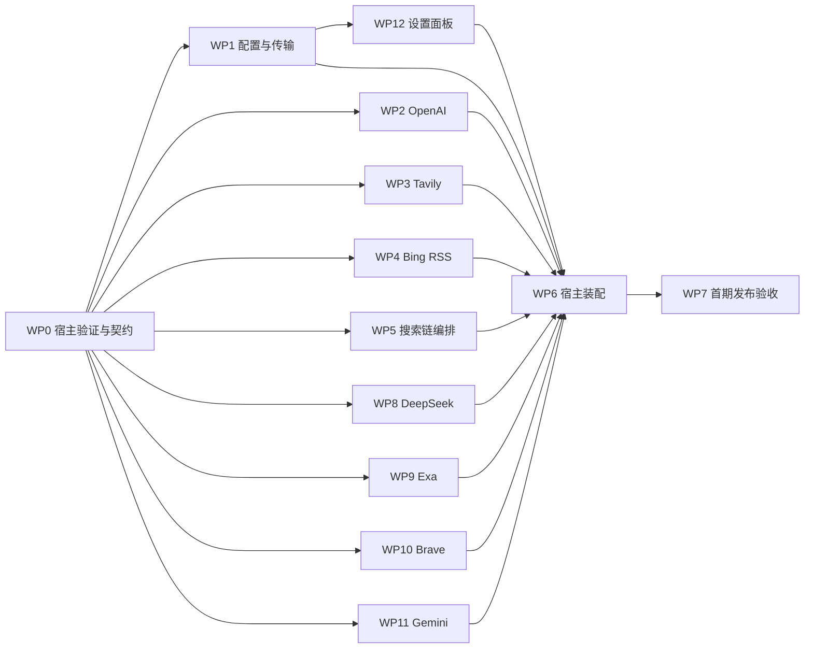

# 并行开发 DAG

## 工作包

| 工作包 | 前置 | 写入范围和验收入口 |
| --- | --- | --- |
| WP0 宿主验证与契约 | 无 | 在测试 profile 验证设置插槽、宿主设置与凭据、官方 DeepSeek 委派。确立 bundle 入口及共享配置、结果和测试约定。见 [DSH 集成](../specs/draft/dsh-integration.md) |
| WP1 配置与传输 | WP0 | `src/config.js`、`src/transport.js`，验证有序快照、逐条 key、代理、PAC 和脱敏。见[配置规格](../specs/draft/config-network.md) |
| WP2 OpenAI | WP0 | `src/backends/openai.js` 及对应测试。见 [OpenAI 规格](../specs/draft/openai.md) |
| WP3 Tavily | WP0 | `src/backends/tavily.js` 及对应测试。见 [Tavily 规格](../specs/draft/tavily.md) |
| WP4 Bing RSS | WP0 | `src/backends/bing.js`，验证 RSS 解析、明确空结果与访问失败。见 [Bing RSS 规格](../specs/draft/bing.md) |
| WP5 搜索链编排 | WP0 | `src/search.js`，验证已保存的顺序、停用、无 key、时间预算及错误。见[降级规格](../specs/draft/fallback.md) |
| WP8 DeepSeek | WP0 | `src/backends/deepseek.js`（单文件服务 `deepseek-search` 与 `deepseek-agentic-search` 两种模式），验证两种自定义模式和官方委派契约。见 [DeepSeek 规格](../specs/draft/deepseek.md) |
| WP9 Exa | WP0 | `src/backends/exa.js` 及对应测试。见 [Exa 规格](../specs/draft/exa.md) |
| WP10 Brave | WP0 | `src/backends/brave.js` 及对应测试。见 [Brave 规格](../specs/draft/brave.md) |
| WP11 Gemini | WP0 | 先验证 DSH 支持同时呈现 Grounded Result 与 Search Suggestions，再接入 `src/backends/gemini.js`。见 [Gemini 规格](../specs/draft/gemini.md) |
| WP12 设置面板 | WP1 | `src/client.js` 和 `src/settings/`，实现添加、编辑、拖动、启停、保存和官方开关。见[设置规格](../specs/draft/settings-ui.md) |
| WP6 宿主装配 | WP1、WP2、WP3、WP4、WP5、WP8、WP9、WP10、WP11、WP12 | 装配入口、统一路由、设置注册和 bundle patch。验证正常 `web_search` 与启用回退。见 [DSH 集成](../specs/draft/dsh-integration.md) |
| WP7 首期发布验收 | WP6 | 用最终候选提交从真实宿主复验设置、七种工具、官方分支和回退，交付用户说明与安装产物。见[路线图](roadmap.md) |

WP0 先确定接口，各工作包按依赖使用独立 worktree 和替身。WP12 可按 WP0 接口先验证界面交互，保存链路在 WP1 可用后验收。WP11 验证展示条件期间，其余适配器和搜索链可独立提交、验证。共享清单、配置合同和装配在其对应工作包维护。
